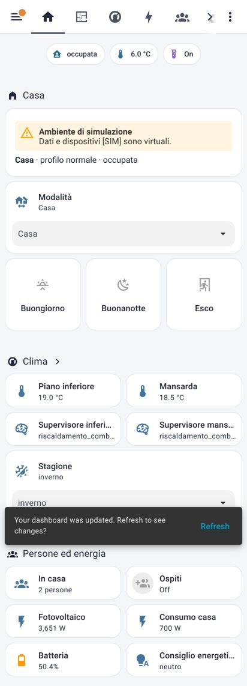
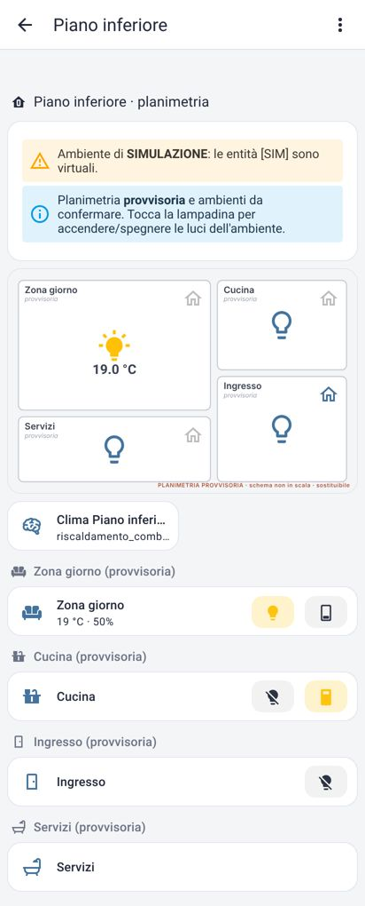
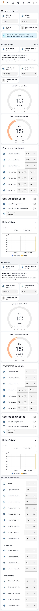

# Stato delle funzioni (v0.1.0)

Legenda:
- 🟢 **operativa**: funziona già in HA, indipendente dall'hardware
- 🟣 **verificata in simulazione**: logica eseguita e testata in HA reale, con dispositivi virtuali
- ⚪ **predisposta**: struttura pronta, inattiva finché manca il dispositivo o il dato
- 🔴 **non verificata**: progettata ma non eseguibile senza hardware

**Nessuna funzione è stata ancora verificata con dispositivi reali.**

## Funzioni

| Modulo | Funzione | Stato |
|---|---|---|
| Ambiente | Avvio HA, validazione `check_config` (prod + dev) | 🟢 verificata su HA Core 2026.2.3 (venv) |
| Ambiente | Avvio via Docker Compose | 🔴 file pronto; non eseguito (immagine non scaricabile nel sandbox) |
| Ambiente | HAOS in VM / Green, add-on, backup | 🔴 procedura documentata |
| Modello | Piani, aree, etichette, associazioni (`hi_tool.py sync`) | 🟢 verificato via WebSocket API |
| Modello | Generazione di pacchetti, viste e planimetrie | 🟢 |
| Dashboard | 7 sezioni + viste per piano, nessuna card in errore | 🟢 verificato con screenshot Chromium (viewport smartphone) |
| Dashboard | Planimetria interattiva (luci per ambiente) | 🟣 |
| Presenza | Occupazione, Assente con ritardo, rientro, ospiti, override, movimento | 🟣 (persone simulate con `device_tracker.see`) |
| Presenza | Companion App reale, zone geografiche, tracker non aggiornati | ⚪ / 🔴 |
| Modalità | Casa / Assente / Notte / Vacanza, scrittore unico | 🟣 |
| Scenari | Buongiorno, Buonanotte, Esco, Rientro, Tutti fuori, Vacanza, Comfort, Risparmio | 🟣 (luci e prese simulate; carico critico mai spento) |
| Notifiche | Livelli, deduplica, anti-ripetizione | 🟢 logbook e persistenti · ⚪ push (serve la Companion App) |
| Diagnostica | Entità offline, comunicazione clima, errori automazioni, stato moduli | 🟣 |
| Clima | Setpoint effettivo (programma, modalità, profilo) | 🟣 |
| Clima | Supervisore: isteresi, tempi minimi, integrazione PdC, inerzia, fail-safe, estate senza pavimento | 🟣 51 test + 4 scenari temporali |
| Clima | Attuazione con consensi (OFF di default), override, rilevamento intervento manuale | 🟣 su `generic_thermostat` simulati |
| Clima | Daikin reale | ⚪ (modelli da verificare) |
| Clima | Termostati pavimento reali | ⚪ |
| Clima | Controllo combinato reale | ⚪ **non attivare** prima della verifica dell'impianto |
| Clima | Raffrescamento estivo con dispositivi | 🟣 solo come logica (i Daikin simulati sono heat-only) |
| Clima | Predittivo (meteo, prezzi, FV, apprendimento) | ⚪ predisposto negli ingressi, non implementato |
| Energia | Proxy W/kWh/%, bilancio, autoconsumo, contatori, costi | 🟣 |
| Energia | Inverter, batteria, Energy Dashboard reali | ⚪ |
| Energia | Gestione carichi | ⚪ solo suggerimenti |
| Google Home | Matter multi-admin, integrazioni dei produttori | 🔴 procedura documentata |
| Sicurezza | Riavvio senza accensioni, nessun comando prima di "sistema pronto", stato del supervisore ripristinato | 🟣 test di riavvio reale |
| Sicurezza | Nessun segreto o coordinata nel repository, simulazione esclusa dalla produzione | 🟢 test statici |

## Esito dei test (ultima esecuzione)

`python3 -m pytest tests` → **92 passed** (≈ 4 minuti), su istanza HA 2026.2.3 avviata dal test:

- `test_static.py` (18): YAML, modello, file generati aggiornati, separazione sim/prod, segreti, etichette, pavimento mai in cool, consensi;
- `test_clima_logica.py` (51): fail-safe, inverno, estate, setpoint, 4 scenari temporali (CSV in `tests/report/`);
- `test_integrazione.py` (23): entità, log senza errori, dashboard e riferimenti, sync, separazione sim/reale, presenza, scenari, planimetria, sensore guasto, attuazione con e senza consensi, override, scostamento manuale, finestra, setpoint, bilancio energetico, notifiche, **riavvio**.

Durante lo sviluppo i test hanno trovato e permesso di correggere problemi reali:
- un test Jinja inesistente;
- `device_tracker.see` non caricato;
- entity_id dei contatori derivati dal nome;
- variabili di entità che non registrano le dipendenze;
- persone senza tracker che rendevano "incerta" l'occupazione;
- sovraelongazione dovuta all'inerzia del pavimento (aggiunta la compensazione `hi_clima_inerzia_ore`).

## Schermate

| Home | Piano inferiore | Clima |
|---|---|---|
|  |  |  |
